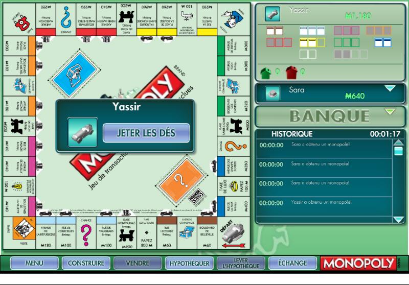
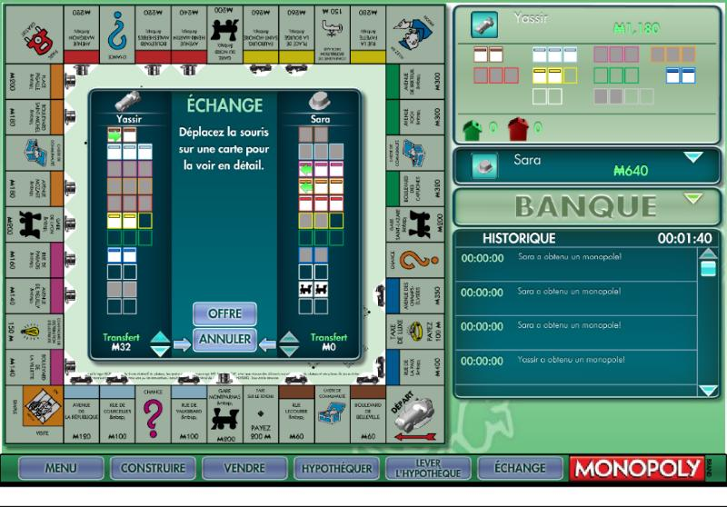
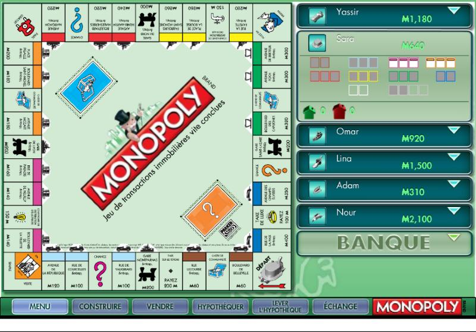
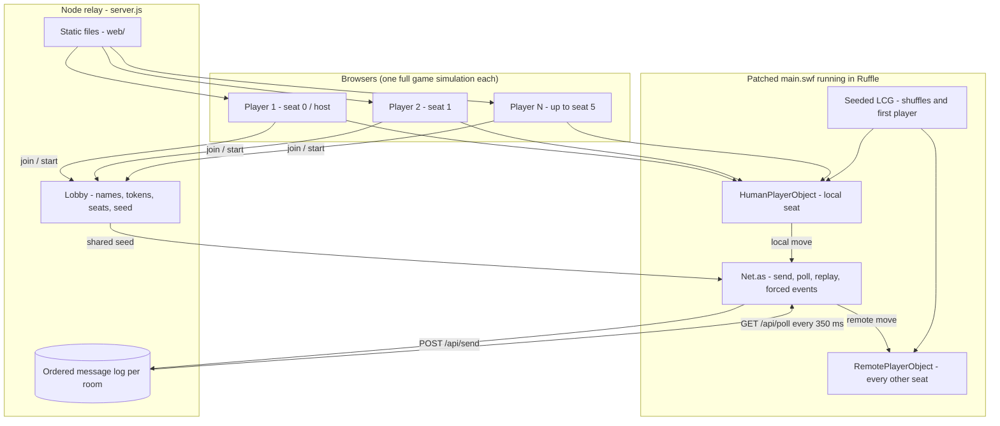

<div align="center">

# Monopoly Online — Multiplayer Monopoly Classic for 2 to 6 Friends

**EA's Monopoly Classic turned into an online game: a deterministic lockstep simulation running in every browser through Ruffle, a tiny zero-dependency Node relay, a lobby where each player picks a name and a token, and automatic rejoin after a refresh.**

<p align="center">
  <strong>Live Application:</strong> <a href="https://monopoly-r2af.onrender.com/">https://monopoly-r2af.onrender.com/</a>
</p>

[](https://monopoly-r2af.onrender.com/)
[](https://github.com/trxshi747/Original-Monopoly-Online)
[](https://nodejs.org/)
[](https://ruffle.rs/)
[](https://en.wikipedia.org/wiki/ActionScript)
[](https://github.com/jindrapetrik/jpexs-decompiler)
[](https://openjdk.org/)
[](https://render.com/)

<br />

<p align="center">
  <a href="https://monopoly-r2af.onrender.com/">Live App</a> •
  <a href="#overview">Overview</a> •
  <a href="#screenshots">Screenshots</a> •
  <a href="#features">Features</a> •
  <a href="#system-architecture">Architecture</a> •
  <a href="#tech-stack">Tech Stack</a> •
  <a href="#quick-start">Quick Start</a> •
  <a href="#deployment">Deployment</a> •
  <a href="#rebuilding-the-game">Rebuild</a> •
  <a href="#test-helpers">Test Helpers</a> •
  <a href="#api-reference">API Reference</a> •
  <a href="#repository-structure">Structure</a> •
  <a href="#frequently-asked-questions-faq">FAQ</a>
</p>

</div>

---

## Overview

**Monopoly Online** replaces the computer opponents of EA's *Monopoly Classic* with your friends. The original game is a compiled Flash application (`main.swf`) that always plays against bots. It was decompiled, patched and rebuilt so that every seat can be a real person, then served as a web page that runs in the browser through **Ruffle**, a Flash emulator written in Rust.

Players open the site, type their own name, choose a token, join a room with a short code and the host presses **Start game**. From that point the server only relays moves: every browser runs the complete game, and the game is deterministic, so everyone sees exactly the same board, dice, cards and auctions.

Up to **6 players** can share a room. A player who refreshes the page or loses the connection can rejoin their seat and is fast-forwarded to the live state without watching the whole game again.

---

## Screenshots

<div align="center">



*The board in a live room: each player has a name, a token and their own properties, and the active player gets the roll dialog.*

<br /><br />



*The trade window: properties are picked on both sides and the cash arrows repeat and accelerate while held, which makes it usable on a phone.*

<br /><br />



*Six players in the same room, with one panel per player showing cash and property cards.*

</div>

---

## Features

- **2 to 6 Players, Real Names**:
  - Each player enters their own name and picks a token in the lobby.
  - Duplicate names are renamed automatically and tokens cannot be picked twice.
  - Layouts for 5 and 6 players hide the History side panel to make room for the extra player panels.

- **Deterministic Lockstep Simulation**:
  - Every client runs the full game logic; the server never knows the rules.
  - A shared seed drives a linear congruential generator used for card shuffles and the starting player.
  - Dice values travel inside the message of the player who rolled, so rolls are identical everywhere.
  - Local actions are sent to the relay, remote actions are injected into the game through a `RemotePlayerObject` that plays the role the bots used to play.

- **Complete Game Coverage**:
  - Buying, auctions with 2 or more players, rent, building and selling houses and hotels, mortgages.
  - Trades with partner selection and the forced unmortgage of traded properties.
  - Jail (bail, doubles, cards), Chance and Community Chest, taxes and bankruptcy with a correct payout to the creditor.

- **Reconnect and Fast Rejoin**:
  - The lobby page remembers the room and seat, and offers a **Rejoin game** button.
  - The returning client replays the server log behind a "Reconnexion… N%" cover with sound muted and the clock accelerated, then hands control back at the live state.
  - Rooms stay in server memory for 6 hours.

- **Desync Protection**:
  - Clicks on dialogs that belong to another player are ignored on every client.
  - Money animations are clamped for 5 and 6 players and can never freeze the rules.
  - If a bankruptcy dialog gets stuck on other screens, the host receives a **Forcer la faillite (hôte)** button after 12 seconds that makes every stuck client declare the bankruptcy.

- **Phone Friendly Trades**:
  - Holding the cash arrows in the trade window repeats the change and accelerates (10, then 30, then 100 per step).
  - Touch scrolling, text selection and the context menu are disabled on the game canvas.

---

## System Architecture



---

## Tech Stack

| Domain | Technologies & Libraries |
|---|---|
| **Game Runtime** | Ruffle (Flash emulator on WebAssembly), original EA Monopoly Classic (`main.swf`, ActionScript 3 / Flex) |
| **Networking** | Node.js 18+ HTTP server with no dependency, JSON messages, 350 ms long polling, ordered per-room log |
| **Frontend** | Plain HTML, CSS and JavaScript lobby (`web/index.html`) that launches Ruffle with the room parameters |
| **Reverse Engineering** | JPEXS Free Flash Decompiler 26.3 (script export and import, library compiler for the new classes), Java |
| **Patching** | Node.js scripts that re-apply the edits to the pristine decompiled sources |
| **Deployment** | Render free web service (`render.yaml`), or any Node host, or a Cloudflare tunnel from your own PC |

---

## Quick Start

### 1. Prerequisites
- **Node.js**: `v18` or higher ([Download](https://nodejs.org/))
- **A modern browser**: Ruffle is loaded from the web page, nothing to install on the player side
- **Java** (only to rebuild the game, see [Rebuilding the Game](#rebuilding-the-game))

### 2. Clone the Repository
```bash
git clone https://github.com/trxshi747/Original-Monopoly-Online.git
cd Original-Monopoly-Online
```

### 3. Start the Server
```bash
node server/server.js
# Monopoly server listening on port 8080
```

### 4. Play
1. Open `http://localhost:8080` (or the address of the PC on your local network).
2. Everyone types their own name, picks a token and enters the same room code.
3. The first person to join is the host and presses **Start game**.

---

## Deployment

On [Render](https://render.com/): create a **Web Service** from the Git repository, leave the build command empty and use `npm start` as the start command. `render.yaml` already describes the service. The production instance of this project runs at [https://monopoly-r2af.onrender.com/](https://monopoly-r2af.onrender.com/); share the URL Render gives you with your friends.

- Free instances sleep when idle, so the first load can take around 30 seconds.
- Any push to the production branch triggers a new deployment.
- Alternatively run the server on your own PC and expose it with a tunnel, for example `cloudflared tunnel --url http://localhost:8080`.
- Restarting the server loses the running rooms, because they live in memory.

> The game files in `web/` belong to EA and Hasbro. Keep the site private and only share the link with friends.

---

## Rebuilding the Game

`web/game.swf` is generated from the original `main.swf` plus the patched ActionScript sources in `src/`.

```bash
bash build/build.sh
```

The build needs Java. FFDec lives in `tools/ffdec`. The patch scripts `build/patch_game.js` and `build/patch_small.js` re-apply every edit to the pristine decompiled files in `build/orig/`, then `build.sh` imports the patched scripts and appends the new `Json`, `Net` and `RemotePlayerObject` classes before the original entry point.

---

## Test Helpers

`web/test.html` loads `game.swf` directly from URL parameters, without the lobby:

```text
test.html?swf=game.swf&room=R&seat=0&n=2&seed=1&names=["A","B"]&tokens=[4,3]
```

The room must already exist and be started (use the lobby, or call `/api/join` and `/api/start`). Add `rejoin=1` to replay as a returning player. Optional scenario parameters are applied identically on every client and ignored when absent:

| Parameter | Example | Effect |
|---|---|---|
| `dbgown` | `0:1,3;1:6,8,9` | Properties owned at the start (`seat:properties`) |
| `dbgcash` | `0:1500;1:10` | Starting cash per seat |
| `dbgmort` | `0:21,23` | Properties that start mortgaged |
| `dbgrolls` | `J,7,4` | Scripted dice sums (`J` sends the player to jail) |

---

## API Reference

| Method | Endpoint | Description |
|---|---|---|
| `POST` | `/api/join?room=CODE&name=NAME&token=N` | Creates the room if needed and returns the seat. Fails when the room is full (6 players) or already started. |
| `GET` | `/api/lobby?room=CODE&seat=N` | Returns the players, their tokens and whether the game started. |
| `POST` | `/api/start?room=CODE&seat=0` | Host only. Starts the game and draws the shared random seed. |
| `POST` | `/api/send?room=CODE&seat=N` | Appends one JSON message (roll, buy, build, trade, bid, forced bankruptcy…) to the room log. |
| `GET` | `/api/poll?room=CODE&since=N` | Returns `{ total, msgs }` with every message after position `N`. Used for live play and for rejoin. |

Messages are limited to 64 KB, room codes to 12 letters and digits, and player names to 16 characters.

---

## Repository Structure

```text
Original-Monopoly-Online/
├── README.md                 # Project documentation
├── package.json              # npm start launches the relay
├── render.yaml               # Render web service definition
│
├── server/
│   └── server.js             # Rooms, lobby, message relay and static files
│
├── web/
│   ├── index.html            # Lobby: name, room code, token, rejoin, launch
│   ├── test.html             # Developer loader driven by URL parameters
│   ├── game.swf              # Patched main.swf (generated by build/build.sh)
│   ├── monopoly_config.xml   # Original game configuration
│   └── assets/               # Original audio, strings and graphics
│
├── src/scripts/              # Decompiled ActionScript (patched files and new classes)
│   └── com/ea/monopolyclassic/
│       ├── game/             # MonopolyGame and Board (rules, state machine)
│       ├── ui/               # Dialogs, trade window, panels
│       ├── common/           # MonopolyApp (entry point and main loop)
│       └── net/              # Net, RemotePlayerObject, Json (online layer)
│
└── build/                    # Rebuild tooling: build.sh, patch scripts, FFDec library compiler
```

---

## Frequently Asked Questions (FAQ)

<details>
<summary><b>1. Do the other players need to install anything?</b></summary>
<br>
No. The page loads Ruffle itself, so a recent desktop or mobile browser and the link are enough.
</details>

<details>
<summary><b>2. What happens if someone refreshes or loses the connection?</b></summary>
<br>
They open the same site and press <b>Rejoin game</b>. Their browser remembers the room and the seat, the client fast-forwards the game from the server log behind a progress cover, then gives control back at the live state.
</details>

<details>
<summary><b>3. Can the server cheat or see my hand?</b></summary>
<br>
The server only stores and relays moves and does not know the rules. All the logic runs in the browsers, and Monopoly has no hidden information beyond the shuffled card decks, which come from the shared seed.
</details>

<details>
<summary><b>4. A player went bankrupt but the dialog is still shown on other screens.</b></summary>
<br>
After 12 seconds the host gets a <b>Forcer la faillite (hôte)</b> button on that dialog. Clicking it broadcasts a force message and every client still stuck on the dialog declares the bankruptcy.
</details>

<details>
<summary><b>5. Why is the end of the game a simple dialog?</b></summary>
<br>
The original end-of-game screen needs Pogo service files that are not part of the game, so it is replaced by a "winner" dialog.
</details>

<details>
<summary><b>6. Why was the whole game history replayed in older versions when rejoining?</b></summary>
<br>
Because the state lives only in the browsers, the only way to rebuild it is to replay the log. The current version does it silently at high speed instead of in real time.
</details>

---

## License

This project is proprietary. The Monopoly Classic game files belong to Electronic Arts and Hasbro and are not covered by any license granted here. All rights reserved.

<div align="center">
  <sub>Built by <a href="https://github.com/trxshi747">trxshi747</a>.</sub>
</div>
